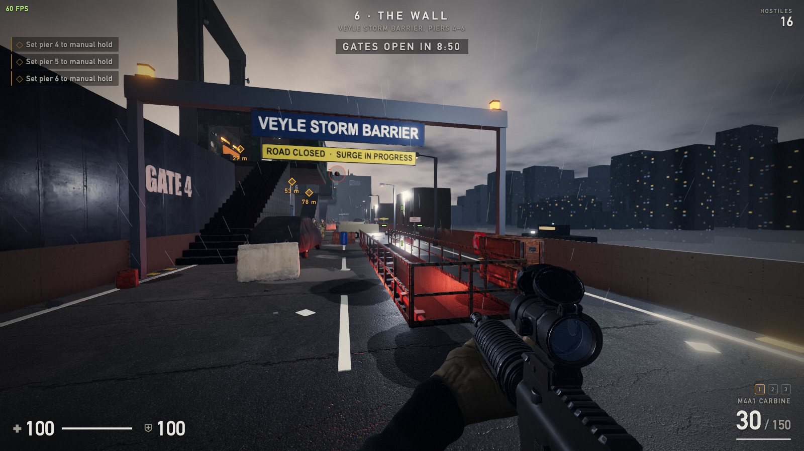
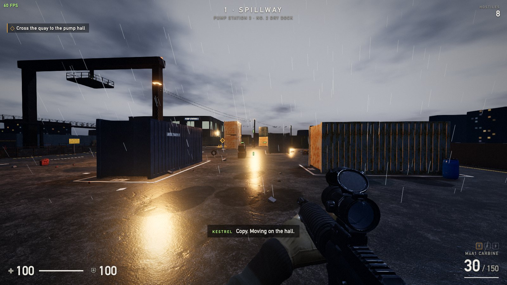
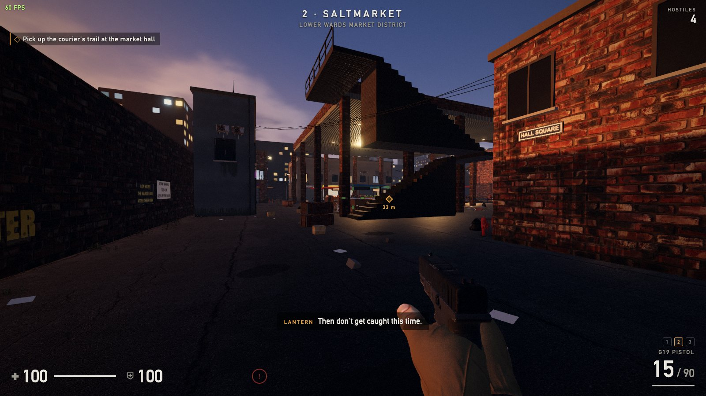
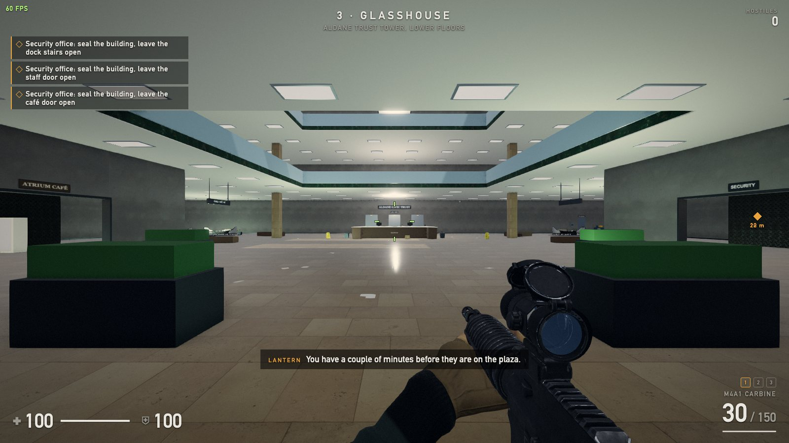
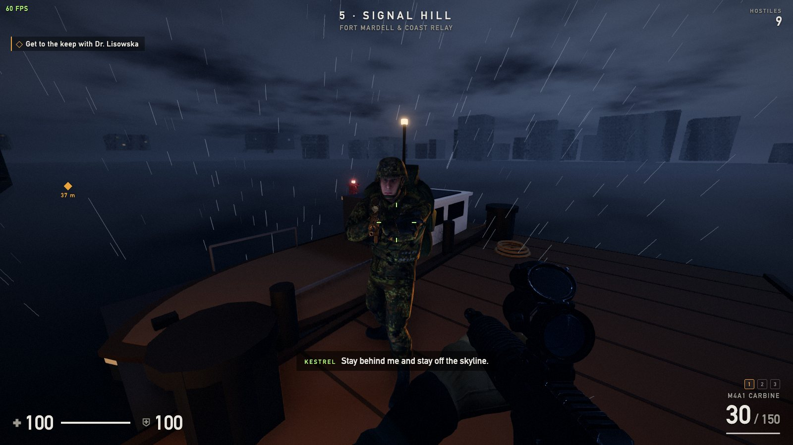
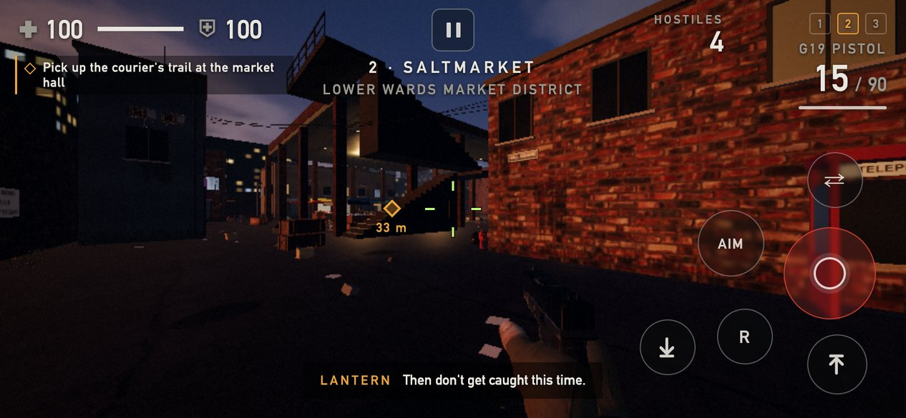

# BREACHPOINT

Browser FPS (Three.js + TypeScript + Vite) with a six-mission story campaign, **Low Water**, a **Wave Survival** mode and a **Practice Range**. Plays with mouse and keyboard, or with touch controls on phones and tablets.



| | |
| --- | --- |
|  |  |
| **1 · Spillway**: the pump station quay, night, rain | **2 · Saltmarket**: the market district at dusk, pistol only |
|  |  |
| **3 · Glasshouse**: the Trust tower, lockdown | **5 · Signal Hill**: the landing stage below the sea fort, storm |



*On a phone: floating move stick, drag to look, a fire button that also steers.*

## Run

```bash
npm install
npm run assets   # downloads the free CC0 assets (~450 MB) into public/assets
npm run sounds   # (re)generates the sound effects into public/assets/audio
npm run voices   # (re)generates the enemy callout voices (macOS `say`; see scripts/make_voices.py)
npm run dev      # http://localhost:5173
```

## Developer options

`F2` opens a developer panel (on a phone, the **DEV** button next to pause). It only exists in the
local dev server (`npm run dev`); production builds (`npm run build`, Docker) leave it out of the
bundle, so a deployed copy has no way to open it. To try it on a phone, run
`npx vite --host` and open the Network URL it prints, adding `?touch=1` on a desktop browser.

- start any chapter, skip the current objective, jump to it, restart the checkpoint, kill every bot
- god mode, infinite ammo, frozen bots, time scale from 0.1× to 2×
- a free-fly camera (mouse and WASD, Space/C for up and down, Shift for speed, Esc to stop)
- hide the HUD, the AI debug overlay, switch graphics quality, save a screenshot
- live stats: fps, frame time, draw calls and triangles for the whole frame, bots alive, positions

## Deploy (Docker)

The image builds the game and serves it with nginx. The first build stage downloads the CC0 assets
itself, so a fresh clone is enough; that layer stays cached until `scripts/fetch-assets.py` changes.

```bash
docker compose up -d --build     # http://<server>:8080, health check at /health
# or
docker build -t breachpoint . && docker run -d -p 8080:80 --restart always breachpoint
```

On Dokploy: create an application from this repo with the **Dockerfile** build type and point the
domain at container port **80** (Traefik handles TLS). No environment variables are needed.

## Story: Low Water

Six missions in a flood city during the 40 hours before a storm surge (concept and map plans:
[docs/story-and-maps.html](docs/story-and-maps.html)). Each has its own multi-level map, a briefing,
radio lines with subtitles, objectives with markers, and checkpoints at every objective.

| # | Mission | Map | What you do |
| --- | --- | --- | --- |
| 1 | Spillway | Pump station and dry dock, night, rain | Cross the quay (or go under it, or over it), open the valve, retake the control room |
| 2 | Saltmarket | Market district at dusk, then a blackout | Pistol only: follow the courier's trail over the canal, breach the safehouse three ways |
| 3 | Glasshouse | Trust tower around an atrium | Choose which entry stays open, hold the vault, clear the boardroom, hold the lobby |
| 4 | Line 9 | Closed station, flashlight | Find the doctor, then escort her west through the tram and up the vent shaft as it floods |
| 5 | Signal Hill | Sea fort in a storm | Three ways up the cliff, hold the relay during the upload, cover the gate, get back to the boat |
| 6 | The Wall | Storm barrier, surge peak | Three piers against the clock, take the tower, lock the gates, hold, and one choice |

How it is built:

- `src/world/level.ts` is the level kit: slabs, walls with door and window gaps, box-tread stairs,
  rails, floors with openings, lamps, doors that open at runtime, water sheets, and the
  environments (night rain, dusk, overcast, underground, storm, dawn storm) with rain and lightning.
  Maps are in `src/world/maps/`. Convention: y = 0 is the lowest walkable level of every map.
- `src/world/dress.ts` is the set-dressing kit on top of it: facades, shop fronts, signs and
  stencils drawn into one texture atlas, grime streaks, puddles, pipes, ducts, cable trays, pallets,
  sandbags, bollards, validated prop scatter and the skyline. Dressing never changes collision
  unless it says so.
- `src/world/props.ts` draws the props. Sizes come from `src/world/props.json` (regenerate with
  `node scripts/prop-bounds.mjs` after adding a model), so a map only loads the models it places.
  Each part gets three levels of detail (meshoptimizer, capped triangle budgets), instances are
  bucketed into 20 m cells for culling, small props disappear at distance, and all prop shadows
  come from one merged low-detail mesh only the sun's shadow camera sees. A map's textures are
  freed when it is unloaded. `await __perf('<mission>')` in the dev console reports frame cost.
- `src/game/mission.ts` runs a mission: stages of tasks (reach, use, clear a group, hold for a
  time), spawn groups by faction, a radio queue, countdowns, rising water, checkpoints.
  The missions themselves are data plus small hooks in `src/game/missions/`.
- The engine works across floors: the navmesh keeps stairs (treads are 0.45 m deep because Recast
  drops anything steeper), bots store what they know in 3D and take cover on their own floor, and
  ray tests walk a grid instead of every box (`src/world/physics.ts`).
- Adapted from the concept for now: no civilians or tailing in Saltmarket, no recon drone, gunboat
  or wave knock-downs, and shield heavies are plain armoured heavies. Allies do not fight.

With the dev server running, the console has helpers for checking a mission without playing it
(`src/dev.ts`): `await __start('spillway')`, `__tp(x, y, z)`, `__run(seconds)`, `__kill('group')`,
`__paths(points, pairs)`, `__st()`.

## Weapons

| Key | Weapon | Notes |
| --- | --- | --- |
| 1 | M4A1 carbine | Full auto, red-dot sight you look through, learnable spray climb |
| 2 | G19 pistol | Semi-auto 9 mm, iron sights, slide locks back on empty |
| 3 | Ultima Ratio sniper | Bolt action with a detachable box magazine, magnified scope overlay, hold Shift to steady your breath |

Switch with `1` `2` `3`, `Q` or the mouse wheel. `R` reloads (from empty the reload also
sends the bolt or slide home), `F` inspects, `F3` shows the AI debug overlay.
On phones and tablets (or with `?touch=1`) on-screen controls replace the keyboard and mouse
(`src/ui/touch.ts`): a floating move stick on the left (push past the ring to sprint), drag to look
on the right, a fire button that also steers, aim and crouch toggles, and "use" and "hold breath"
buttons that show up when they apply. The first run on a touch device starts on Low quality.

Firing an empty gun clicks and reloads; with no ammo left it switches to a gun that has some.

`E` picks up what you are looking at: a fallen enemy's gun (you reach for it and bring it up in
place of the one you hold, or strip its magazine if you already carry that gun) or the body itself,
searched once for spare ammo (`src/world/loot.ts`).

## Animation

- First-person arms: a purpose-built arms model (`fp_arms.glb`), sized by its hand so any rig holds
  the guns at the same scale, solved with two-bone IK onto hand anchors on the
  weapon (`src/weapons/arms.ts`, `src/core/ik.ts`). The elbow swings to keep the wrist straight,
  the forearm shares the wrist's roll, and the shoulders give way so an arm is never folded up
  into view.
- Grips are solved against the gun's real mesh, not proxy shapes (`src/weapons/grip.ts`,
  `src/weapons/surface.ts`): each anchor says roughly where a hand goes, then the palm is seated
  on the surface and every finger closes until its skin touches. Finger thickness and flexion
  axes are measured from the hand model, so another rig with Mixamo bone names drops in. Grips
  are solved once at load (about 30 ms for all three guns) and blended at runtime. A hand moving
  between grips lifts off, opens, and is pushed clear of the gun on the way.
- Weapon actions are keyframed timelines (`src/weapons/timeline.ts`, data in `weapons.ts`): draw,
  holster, tactical/empty reloads, bolt cycling, inspect and reaching for loot. They move the gun,
  its parts (magazine, bolt, slide) and send each hand to a named grip; events play the recorded
  sounds. The pistol's old magazine drops into the world as a physics prop; casings eject.
- Against a wall the gun comes back into a high ready instead of poking through it.
- Spring-based kick, mouse-lag sway, strafe tilt, walk bob, sprint and landing.

Adding a gun: give it rough hand anchors in `weapons.ts`, then in the dev console run
`__game.weapons.fitGrip('guard', 'l')` for each one. It tries nearby placements, keeps the one
that puts most of the hand on the model, applies it live and returns the numbers to paste back.
`__game.weapons.debugHands = { l: 'mag' }` holds a hand on an anchor so you can look at it.

The M4 is "Classic M4" from Sketchfab, exported through Blender with its sight lenses removed so you can
look through the tube (the game adds its own glass and projected dot). If `public/assets/models/m4/m4.glb`
is missing, the procedural M4 in `src/weapons/m4.ts` is used instead.

## Bots

- Navigation: Recast/Detour navmesh baked from the map at load, Detour crowd for movement with
  local avoidance (`src/world/navmesh.ts`, `recast-navigation`).
- Perception: vision cone with an awareness meter (distance, stance, movement, how much of you is
  visible), hearing (gunshots, footsteps, reloads), memory with short-term prediction.
- Squad (`src/enemies/squad.ts`): radio-delayed shared intel, at most 3 bots shooting at once
  (attack tokens), flankers on opposite sides, camping detection, grenade timing.
- Tactics (`src/enemies/enemies.ts`): cover chosen by the least-exposed route, peek and lean,
  suppressing fire at your last position, flanking, pushing when you reload or are hurt,
  falling back when hurt, reloading behind cover, dodging when you aim at them, fleeing grenades,
  never shooting through squad mates. Bullets are traced for real, so cover stops them.
- Roles and weapons: riflemen (M4) work cover to cover, flankers (pistol) close the distance before
  they fight, rushers run you down, and marksmen (bolt-action) hang back, kneel and line up a shot.
  A marksman's scope glints and grows while he settles: stand still and you get hit, move and he
  mostly misses. Bots in cover lay down covering fire while a squad mate crosses open ground.
- Models: three soldier models share one set of animations (`SOLDIER_MODELS` in `enemies.ts`); each
  spawn picks one and gets a slightly different height. Any Mixamo-rigged character exported in
  T-pose can be added to that list.
- Animation (`src/enemies/rig.ts`): strafing and backpedalling (lower body turns, walk clip runs in
  reverse), crouch-walk, lean, procedural reload with a dropped magazine, grenade throw,
  directional flinch and stagger, bone-capsule hitboxes (head, torso, arms, legs).
  Per-weapon holds (rifle in the shoulder, pistol pushed out two-handed, long rifle), a head that
  tracks what the bot is looking at, a body that leans into runs, turns and stops, and a gun that
  rides the stride and the breath and swings onto its target instead of snapping.
- Death: Rapier ragdoll with hinge-limited knees and elbows that inherits the body's motion and the
  bullet's push; the rifle drops as a physics prop (`src/enemies/ragdoll.ts`, `src/world/physics3d.ts`).

## Online

Not networked yet, but the simulation runs in fixed 60 Hz ticks from serializable
`PlayerCommand`s and reports through `GameEvent`s. See [docs/ONLINE.md](docs/ONLINE.md).

## Assets

- Models, textures and HDRI: [Poly Haven](https://polyhaven.com) (CC0) — the story maps add twelve more texture sets and about a hundred set-dressing props, fetched by `npm run assets`
- "Classic M4" by [jeandiz](https://sketchfab.com/jeandiz) — [Sketchfab](https://sketchfab.com/3d-models/a747ebdbb3d941ecb09b459c62865a75), CC BY 4.0 (sling removed, lens faces removed, textures resized to 2K)
- "Pistol 9mm - semi auto" by Hitansh_3DArtist (Sketchfab), CC BY 4.0 (exported through Blender with the muzzle down -Z, slide and magazine split into their own nodes). `public/assets/models/g19/g19.glb`
- "PGM Ultima Ratio · Game-Ready Sniper Rifle" by flip.3d (Sketchfab), CC BY 4.0 (bipod and monopod removed, bolt and magazine split into their own nodes). `public/assets/models/ultima_ratio/ultima_ratio.glb`
- "First Person arms" by [bumstrum](https://sketchfab.com/bumstrum) — [Sketchfab](https://sketchfab.com/3d-models/e3c42c05b22944e5839deb8e003f0987), CC BY 4.0 (bones renamed to Mixamo names, two forearm twist bones added per arm, textures as JPEG). `public/assets/characters/fp_arms.glb`; the soldier's own arms are used if it is missing.
- "German KSK operator - rigged" and "German Bundeswehr soldier - rigged" by [42manako](https://sketchfab.com/42manako) — Sketchfab ([KSK](https://sketchfab.com/3d-models/110daf3d1884412989e41dc95866c579), [Bundeswehr](https://sketchfab.com/3d-models/3d7944fea17b494abf220cc11ddabfd1)), CC BY 4.0 (re-posed to a T-pose, bones renamed to Mixamo names, textures as JPEG)
- "American Soldier Rigged" by [matheofrelin3](https://sketchfab.com/matheofrelin3) — [Sketchfab](https://sketchfab.com/3d-models/5b1967e7f83547be8a1c3ae656ab1ad4), CC BY 4.0 (bones renamed to Mixamo names)
- Idle/Walk/Run clips: three.js examples `Soldier.glb` (Mixamo-derived), retargeted at load time by `src/enemies/retarget.ts`.
  This character is also the fallback if `us_soldier.glb` is missing.
